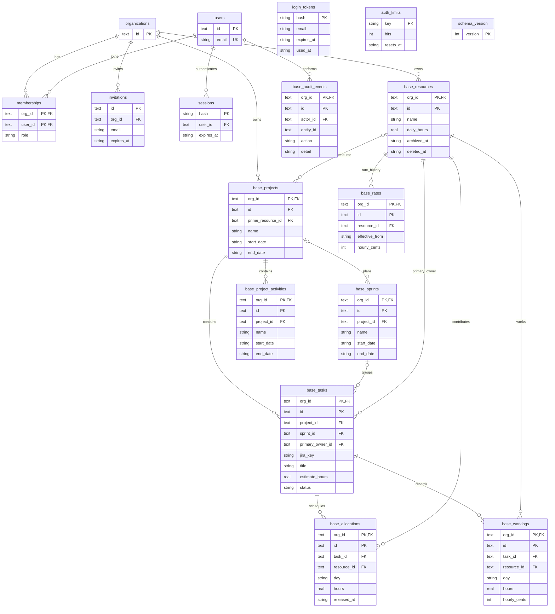

# Resource Management SQLite schema

The live database is `data/resource-compass.db`. Organization-owned physical tables have a `base_` prefix; the API accesses them through organization-filtered queries. Composite `(org_id, id)` keys and foreign keys keep related records in the same organization. This diagram shows the actual table names and principal relationships; `apps/api/sqlite_schema.sql` defines every column, constraint and append-only trigger.

- Every task belongs to a project; sprint membership is optional. New sprints require a project, while legacy unassigned sprints can be linked through the editor.
- The primary owner is responsible for a task. Multiple resources can contribute through separate dated allocations and worklogs.
- Rates are append-only effective-date records. Worklogs snapshot the applicable rate so later rate changes do not rewrite recorded cost.
- Hold/reassignment/deletion releases future allocations while retaining history. Project/resource removal uses markers; unused project activities can be deleted with audit snapshots.
- Audit entity IDs intentionally refer to different entity types without a single-table foreign key.
- Login tokens refer to email addresses before an invited user necessarily exists; they do not have a user foreign key.
- SQLite schema version 1 is independent of the historical PostgreSQL migration sequence.
